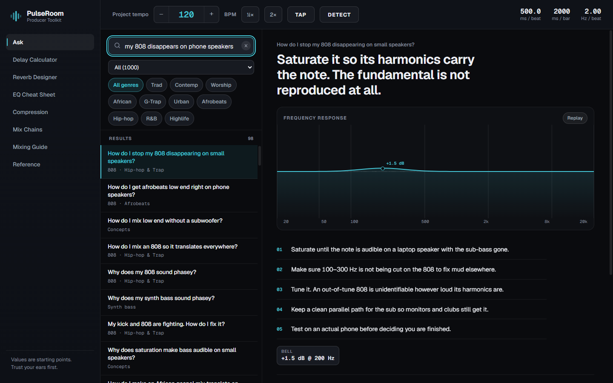
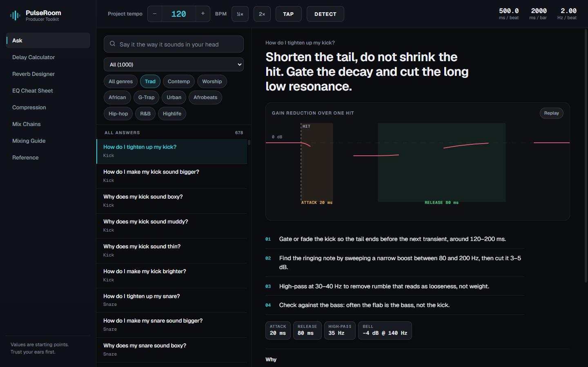
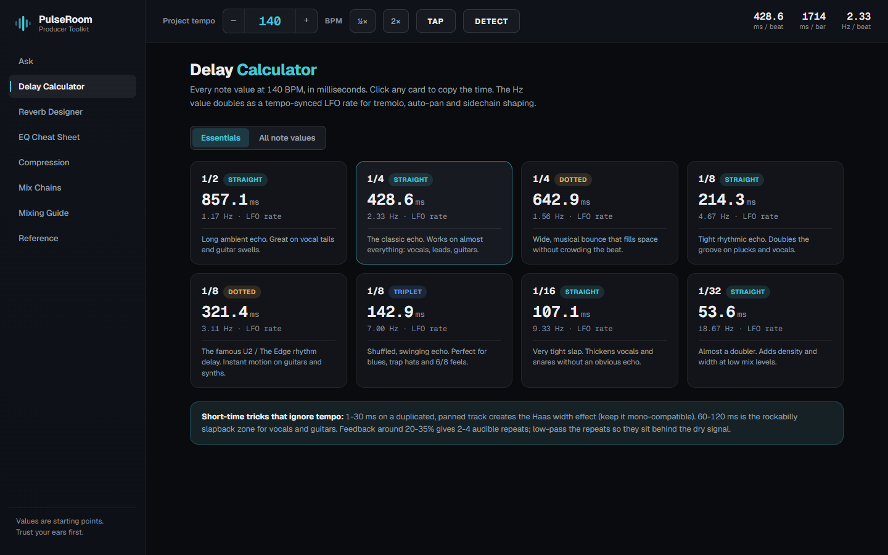
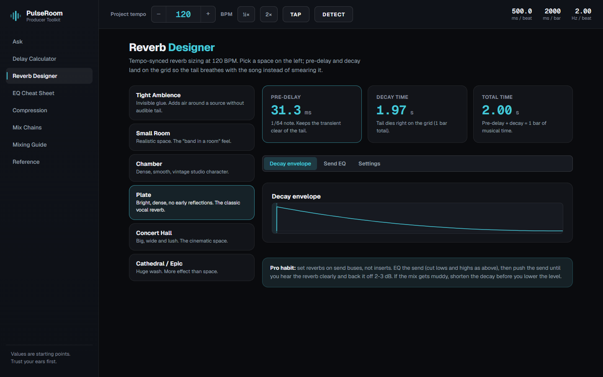
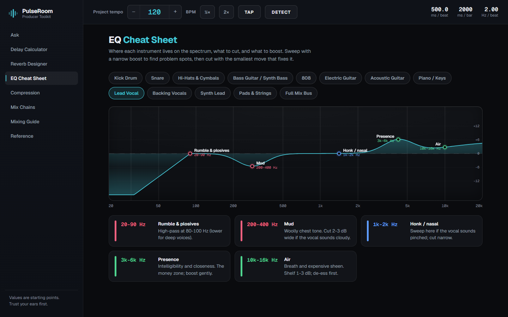
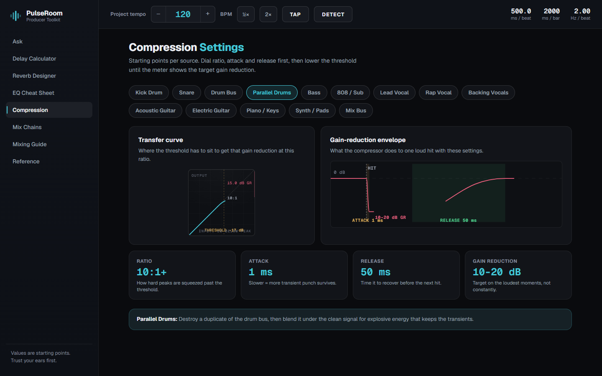
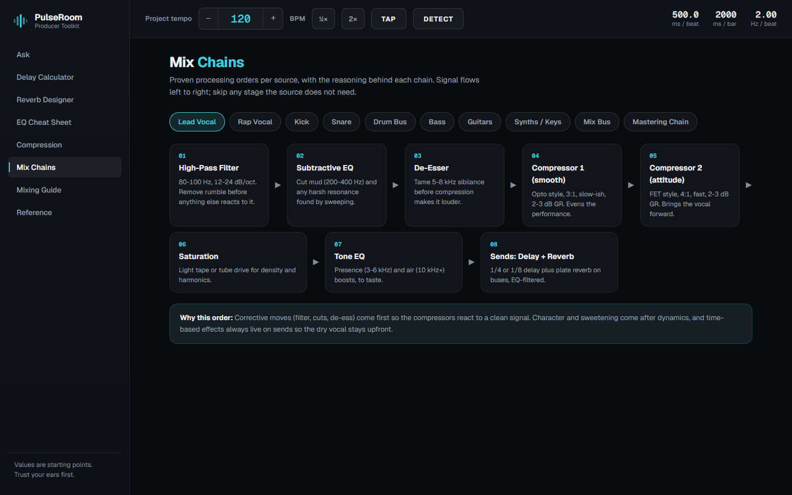
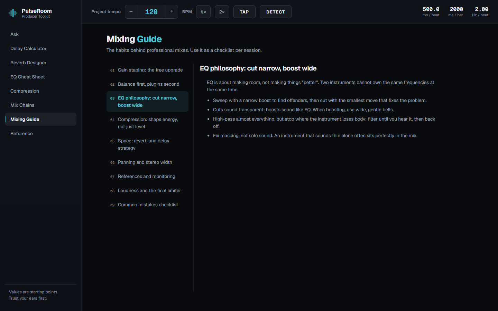
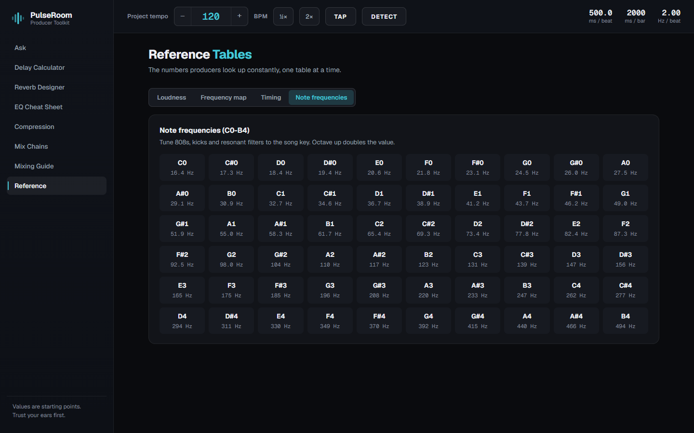

# PulseRoom — marketing document

Amanorsac Studio · prepared 2026-10-22 · build 1.2.0

Screenshots in `release/screenshots/`, captured from the built app at
1440×900. Real screens, real data, no mock-ups.

---

## What it is, in one line

**A mixing engineer you can ask a question, built for the genres nobody else
builds reference tools for.**

---

## The position

Every producer reference tool on the market is written for rock, pop and EDM.
A producer mixing Ghanaian highlife, Nigerian afrobeats or traditional gospel
opens one of them and finds nothing about a talking drum, nothing about a
Hammond swallowing a choir, nothing about where the log drum sits against the
bass.

PulseRoom answers **1,000 specific questions**. 284 of them were written for
one genre and one genre only; 592 carry a genre tag. Six separate Gospel
sub-styles are treated as what they are: six genres that mix differently.

That is the whole pitch. It is not a better EQ chart. It is the only one of
these written for this music.

---

## The numbers, all verified

| | |
|---|---|
| Answered questions | **1,000** |
| Instruments and sources covered | **37** |
| Genres, separately treated | **11** |
| Works offline | completely — no account, no network call, ever |
| Platforms | Windows, macOS, Android, iOS |

Genre breakdown: Gospel Traditional, Contemporary, Praise & Worship, African
Gospel, Gospel Trap, Urban Gospel, Afrobeats, Hip-hop & Trap, R&B, Highlife,
plus answers that apply across all of them.

---

## The screens

### 01 — Ask

The reason the product exists. Type the question the way you would say it out
loud — *"my 808 disappears on phone speakers"* — and get a one-line verdict, an
animated visual, numbered steps, the parameters to copy, and the reasoning
underneath.

Search is synonym-expanded and offline. There is no dead end: an unmatched
query falls back to the nearest answers rather than an empty page.

**The line that sells it:** every answer tells you *why*, and tells you what
goes wrong. Not just what to set.

### 02 — Browsing by genre

Filter by any of 37 sources or 11 genres. Select Traditional Gospel and the
answers change — because mixing a Hammond under a twenty-voice choir is not
the same problem as mixing a pad under a synth lead, and the app does not
pretend it is.

### 03 — Delay Calculator

Every note value at your project tempo, in milliseconds and in hertz. Tap any
card to copy. Answers that prescribe a note value link straight here with the
right card already ringed.

### 04 — Reverb Designer

Six spaces, each with tempo-synced pre-delay and decay so the tail lands on the
grid instead of smearing across it. Decay envelope and send-EQ curve shown, not
described.

### 05 — EQ Cheat Sheet

A real equaliser curve, not coloured blocks. The app reads each zone the way a
plugin would: a cut from 20 to 90 Hz becomes a high-pass, a boost from 10k to
16k becomes a shelf, and everything else is a bell whose Q comes from its
bandwidth. Thirteen sources.

### 06 — Compression

The transfer curve every compressor shows, beside the gain-reduction envelope —
one says how hard, the other says how fast. The threshold is **derived** from
the ratio and the target gain reduction, which is the relationship most people
get wrong by feel, so the number is printed on the plot.

### 07 — Mix Chains

Plugin order per source, with the reasoning for the order rather than just the
list.

### 08 — Mixing Guide

Nine sections on the habits behind professional mixes. Written as a checklist
to use per session, not an article to read once.

### 09 — Reference

Loudness targets per platform, the frequency map, psychoacoustic timing
windows, and note-to-frequency for tuning 808s and resonant filters.

---

## What makes it defensible

**The genre depth cannot be copied quickly.** 284 answers written for a single
genre is months of writing by someone who actually mixes this music. A competitor can
add an EQ chart in an afternoon; they cannot add an answer about whether the
organ pedals or the bass guitar should hold the low end.

**It works with no internet and no account.** Nothing is collected, nothing is
transmitted, nothing is stored. That is a feature in markets where data costs
money, and it is also why there is no subscription to churn out of.

**Every answer carries its reasoning.** The product teaches rather than
instructs, which is what turns a reference tool into something a producer keeps
open.

---

## Store listing copy

**Short description (under 80 characters)**

> 1,000 answered mixing questions. Gospel, Afrobeats, Hip-hop, R&B, Highlife.

**Long description**

> Ask it the way you'd say it out loud. "Why does my 808 disappear on phone
> speakers?" "How do I stop the Hammond swallowing the choir?" "Where does the
> talking drum sit?"
>
> PulseRoom answers 1,000 mixing questions across 37 instruments and 11
> genres — including six Gospel sub-styles treated separately, because they
> mix differently.
>
> Every answer gives you a one-line verdict, numbered steps, the exact
> parameters to copy, an animated visual, and the reasoning behind it.
>
> Plus tempo-synced delay and reverb calculators, EQ and compression reference
> with real curves, plugin-order chains per source, and the loudness targets
> you look up constantly.
>
> Works entirely offline. No account. Nothing collected.

**Keywords**

mixing, mastering, producer, gospel, afrobeats, highlife, hip-hop, R&B, EQ,
compression, reverb, delay calculator, 808, tempo sync, music production

---

## Pricing note

$19 is the stated price. Worth deciding regional pricing at submission rather
than after: the genres this is built for are centred on Ghana and Nigeria,
where $19 is a significantly larger purchase than it is in the US or UK. Both
stores support regional price tiers, and the audience that most needs this tool
is the one most likely to be priced out of it.

---

## What is not in this build, and should not be claimed

Three things to keep out of any copy until they ship:

- **Read-aloud.** The feature works but is hidden for this release. The voice
  it would use is the Windows system voice, and it sounds wrong in a paid
  studio tool. It returns when the rendered audio in Nene's own voice is built.
- **The 1,000th answer is not a round-number claim.** It is 1,000 exactly,
  validated, with no duplicates. Say the number plainly.
- **Installers are not yet signed.** Until the signing secrets are set, Windows
  shows a SmartScreen warning and macOS Gatekeeper blocks the app. Nothing
  should be marketed as "download and run" before that is true.
